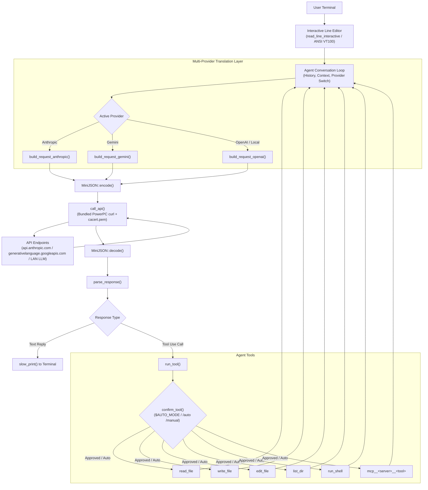

# System Architecture

## High-Level Overview

`ppc-code-ai-agent` is an interactive CLI coding agent designed to run natively on vintage PowerPC Macs (Mac OS X 10.4 Tiger, Perl 5.8.6). Because Tiger lacks modern TLS 1.2/1.3 ciphers in its native OpenSSL and curl, and does not have modern CPAN toolchains or Python 3, this system operates with zero CPAN dependencies, embeds a custom JSON engine, uses a bundled static `curl` with modern TLS capabilities, and exposes autonomous tool use with explicit user confirmation.

## Subsystems & Layers

### 1. Presentation & Terminal I/O Layer
- **Location**: [`code-agent.pl`](../code-agent.pl) (Lines 890–1494)
- **Responsibilities**:
  - Raw terminal management using `stty raw -echo` and `stty cooked`.
  - ANSI / VT100 escape sequence handling (cursor position queries `\e[6n`, arrow keys, home/end, backspace).
  - Terminal size detection via `_probe_terminal_size` and `_query_cursor_pos`.
  - Multibyte UTF-8 input handling avoiding Perl 5.8.6 buffering bugs.
  - History tracking and prompt rendering.

### 2. Multi-Provider & Serialization Layer
- **Location**: [`code-agent.pl`](../code-agent.pl) (Lines 52–106, 134–270, 345–640)
- **Responsibilities**:
  - `MiniJSON`: Zero-dependency recursive descent JSON parser and serializer.
  - Environment & credential management: `load_env_file()` loads `~/.code-agent/env` without overriding existing `%ENV` variables. Legacy `~/.code-agent-env` and `~/.claude-agent-env` files are migrated on installation.
  - Provider configurations for **Anthropic** (`claude-sonnet-4-5-20250929`), **Gemini** (`gemini-3.5-flash-lite`), and **OpenAI-compatible** local endpoints (e.g. Ollama, llama.cpp on LAN).
  - Runtime provider switching via slash commands (`/claude`, `/gemini`, `/openai`).
  - Request schema translation between Anthropic's messages/tools format, Gemini's contents/functionDeclarations, and OpenAI's chat/completions format.

### 3. Network Transport Layer
- **Location**: [`code-agent.pl`](../code-agent.pl) (Lines 272–344), [`curl`](../curl), [`cacert.pem`](../cacert.pem)
- **Responsibilities**:
  - Execution of `$CLAUDE_CURL` (`~/.code-agent/toolchain/bin/curl`, `/usr/local/code-toolchain/bin/curl`, or bundled `./curl`).
  - Strict certificate verification using bundled Mozilla `cacert.pem`.
  - Payload streaming and response capture via temporary files or pipes.
  - Automatic retry mechanism (`call_api` wrapping `_call_api_once`) that retries failed or transient HTTP/JSON/provider API calls up to 3 times (`CLAUDE_MAX_RETRIES`, default `3`) with a 5-second interval (`CLAUDE_RETRY_DELAY`, default `5`).

### 4. Autonomous Tool Execution & Safety Layer
- **Location**: [`code-agent.pl`](../code-agent.pl), [`src/tools.pl`](../src/tools.pl)
- **Responsibilities**:
  - `read_file`: Reads file content in UTF-8, with optional 1-based inclusive `start_line` and `end_line` line slicing and bounds clamping.
  - `write_file`: Overwrites whole file content on local disk with permission checked via `confirm_tool()`.
  - `edit_file`: Replaces a specific line range (`start_line` through `end_line`, 1-based inclusive) with replacement content, deletes lines when content is empty, or inserts lines without deletion (`end_line = start_line - 1`), with bounds clamping and permission checked via `confirm_tool()`.
  - `list_dir`: Scans directory entries excluding `.` and `..`.
  - `run_shell`: Executes arbitrary shell commands via system backticks with permission checked via `confirm_tool()`.
  - `invoke_subagent`: Delegates specialized tasks to an isolated sub-agent loop (up to 50 turns) with turn countdown tracking, supporting `plan` (strictly read-only `read_file` and `list_dir`) and `build` (full implementation tools, including remote MCP tools).
  - Remote MCP Tools: Dispatched through `mcp_execute_tool()` when tool name matches remote registry, prompting `confirm_tool("Call remote MCP tool '$tool_name'?")` in manual mode and executing immediately in auto mode.
  - Prompt Injection Defense: `format_tool_result()` encloses outputs from untrusted-data tools (`read_file`, `list_dir`, `run_shell`, `invoke_subagent`, and all remote MCP tools) in `<untrusted_tool_output tool="$name">...</untrusted_tool_output>` fences after escaping closing tags.
  - `confirm_tool($prompt)`: Permission wrapper that returns `1` immediately when `$AUTO_MODE` is active; delegates to interactive `confirm($prompt)` when manual mode is active (prefixed with `[Sub-agent: $type]` when invoked under a sub-agent).
  - `handle_auto_command($out_fh)` & `handle_manual_command($out_fh)`: Slash command handlers (`/auto`, `/manual`) toggling `$AUTO_MODE`.
  - `get_auto_mode()` & `set_auto_mode($val)`: Encapsulated accessors for `$AUTO_MODE`.

### 5. Session Management & Lifecycle Layer
- **Location**: [`code-agent.pl`](../code-agent.pl), [`src/session.pl`](../src/session.pl)
- **Responsibilities**:
  - `$CURRENT_SESSION`: Package-level session state holding `id`, `created_at`, `provider`, `model`, and `messages` arrayref.
  - `generate_session_id()`: Generates unique timestamped session IDs (`session-YYYYMMDD-HHMMSS-NNN`) combining `localtime` and monotonic `$SESSION_COUNTER`.
  - `init_session([$id])`: Instantiates a fresh session structure with an empty message list and sets `$CURRENT_SESSION`.
  - `get_current_session()`: Lazy accessor ensuring active session availability.
  - `archive_session($session)`: Lifecycle hook invoked immediately before session re-initialization to prepare for future disk persistence and continuation.
  - `handle_new_command($out_fh, $session)`: Command handler for `/new` slash command that archives the current session, re-initializes `$CURRENT_SESSION`, and prints user confirmation.
  - `compact_session_history()` & `auto_compact_session_if_needed()`: Context and token budgeting subsystem tailored for vintage PowerPC CPUs. Truncates large tool result outputs in older turns (beyond 4 user turns, or exceeding 100k characters / 10 turns) while strictly preserving `tool_use_id` / `tool_result` pair consistency.
  - `handle_compact_command($out_fh, $session)`: Command handler for `/compact` slash command for on-demand context compaction.

### 6. Remote Model Context Protocol (MCP) Client Layer
- **Location**: [`code-agent.pl`](../code-agent.pl), [`src/mcp.pl`](../src/mcp.pl)
- **Responsibilities**:
  - **Protocol Engine**: Pure Perl 5.8.6 JSON-RPC 2.0 message builder and parser (`mcp_build_request`, `mcp_build_notification`, `mcp_parse_response`). Normalizes tool definitions (`inputSchema` to `input_schema`) for seamless consumption by Anthropic, Gemini, and OpenAI request adapters.
  - **Secure HTTP Transport**: `mcp_http_post()` executes requests via `$CURL` and `$CACERT` using temporary curl config files (`-K`, permissions `0600`) to protect API keys and tokens from process inspection (`ps`). Tracks `mcp-session-id` headers and enforces a 20-second timeout.
  - **Server Lifecycle & Dynamic Discovery**: Discovers servers from `~/.code-agent/mcp.json`, `./mcp_servers.json`, or environment variables (`CLAUDE_MCP_CONFIG`, `CLAUDE_MCP_SERVERS`). Negotiates MCP handshake (`initialize` -> `notifications/initialized` -> `tools/list`), namespaces tools as `mcp__<server>__<name>` to avoid collisions, and registers them dynamically into global `@TOOLS`.
  - **Runtime Management Command**: `handle_mcp_command()` provides the interactive `/mcp` slash command (`/mcp list`, `/mcp add <name> <url> [headers]`, `/mcp remove <name>`, `/mcp refresh`).

### 7. Build & Modular Assembly Layer
- **Location**: [`build.pl`](../build.pl), [`src/`](../src/), [`Install.command`](../Install.command), [`modern-install.command`](../modern-install.command)
- **Responsibilities**:
  - Modular decomposition of the monolithic codebase into 13 focused modules in `src/` (`header.pl`, `prompts.pl`, `json.pl`, `transport.pl`, `providers.pl`, `models_menu.pl`, `session.pl`, `tools.pl`, `mcp.pl`, `terminal.pl`, `markdown.pl`, `ui.pl`, `main.pl`).
  - `build.pl`: Pure Perl 5.8.6 manifest-driven assembly script concatenating `src/*.pl` into the single-file distribution executable `code-agent.pl`, applying `chmod 0755`, and verifying syntax (`perl -c`).
  - Supports `--check` for CI/CD synchronization checks, and custom `--src-dir` and `--output` paths.
  - `Install.command`: Integrates automated `perl build.pl` rebuild when `build.pl` and `src/` are detected before deploying to `$BUILD_DIR/code-agent.pl` on PowerPC Tiger.
  - `modern-install.command`: Automates modern macOS / Linux deployment utilizing system curl, perl, and shell profile path configuration.

## Data Flow & Lifecycle

1. **User Input**: The user enters a prompt at `User> `. Characters are read one-by-one in raw mode, handling VT100 control codes and UTF-8 multibyte sequences.
2. **Context Assembly**: The prompt is appended to `$CURRENT_SESSION->{messages}` (managed by the session subsystem). Typing `/new` triggers `handle_new_command()`, archiving the old session and resetting `$CURRENT_SESSION` with a clean history without restarting the agent.
3. **Request Serialization**: `build_request()` translates `$CURRENT_SESSION->{messages}`, available `@TOOLS`, and the effective system prompt (composed dynamically from `$SYSTEM_PROMPT` and discovered `AGENTS.md` instructions via `get_effective_system_prompt()`) into the appropriate provider format and encodes it with `MiniJSON::encode()`.
4. **Transport**: `call_api()` spawns `curl` with `--cacert cacert.pem` to POST the payload to the provider endpoint over TLS 1.2/1.3.
5. **Response Parsing**: The returned JSON is parsed with `MiniJSON::decode()` and normalized by `parse_response()` into text blocks or `tool_use` events.
6. **Execution / Feedback**:
   - If text: Printed to STDOUT using `slow_print()` for a vintage terminal typing effect.
   - If `tool_use`: Dispatched to `run_tool()`. Actions with side effects check `confirm_tool()`, which requires interactive `[y/N]` confirmation in manual mode (`/manual`) or executes immediately in autonomous mode (`/auto`). The tool result is wrapped into a `tool_result` message and re-submitted to the API loop until a final text response is produced.
